# WhatsApp Ventas

Sistema de automatización de mensajes de ventas sobre la **WhatsApp Business Cloud API oficial de Meta**: contactos con consentimiento auditable, plantillas aprobadas, campañas programadas, disparadores automáticos (bienvenida, carrito abandonado, recordatorio de pago, post-venta), bandeja de conversaciones, respuestas por palabra clave y dashboard de métricas.

Incluye un **modo sandbox** que no envía nada real: genera notificaciones con la misma forma que los webhooks de Meta y las pasa por el mismo código de producción, así que la demo ejercita el sistema completo.

**Stack:** Python 3.12+ · FastAPI · SQLAlchemy 2 · Alembic · PostgreSQL · Celery + Redis · React 18 + Vite + TailwindCSS 4 · Recharts

> Proyecto de portafolio · Anggie Alcedo


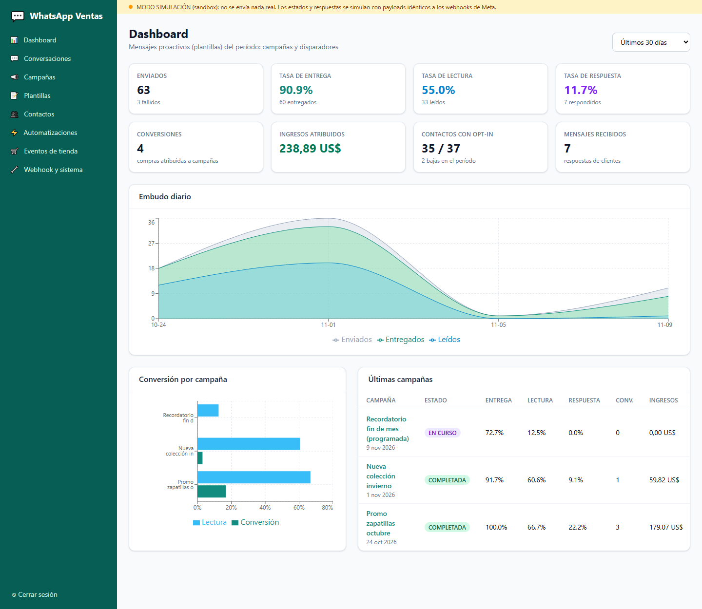

## Capturas

| Bandeja de conversaciones | Detalle de campaña (embudo por mensaje) |
|---|---|
| 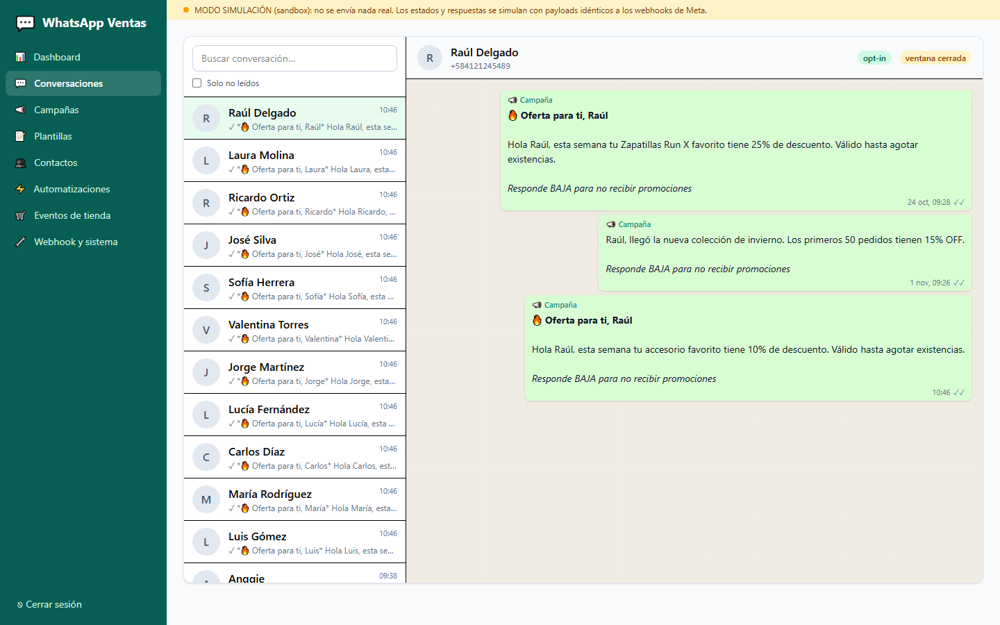 | 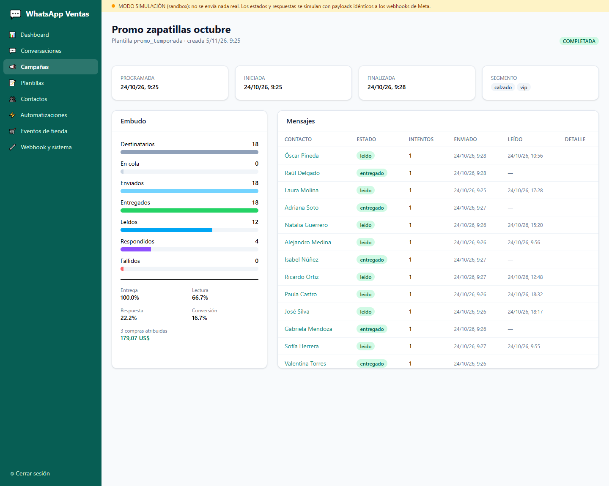 |
| **Campañas** | **Nueva campaña con segmento** |
| 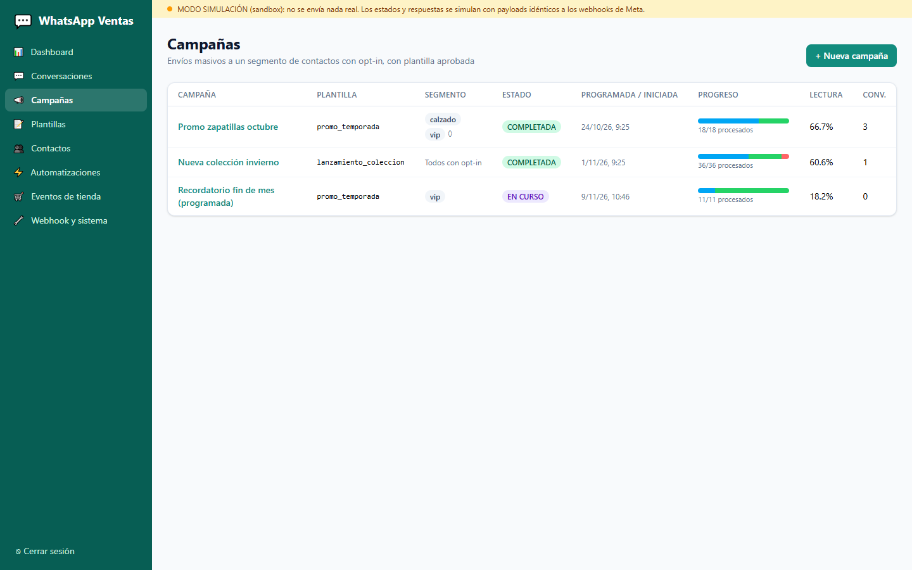 | 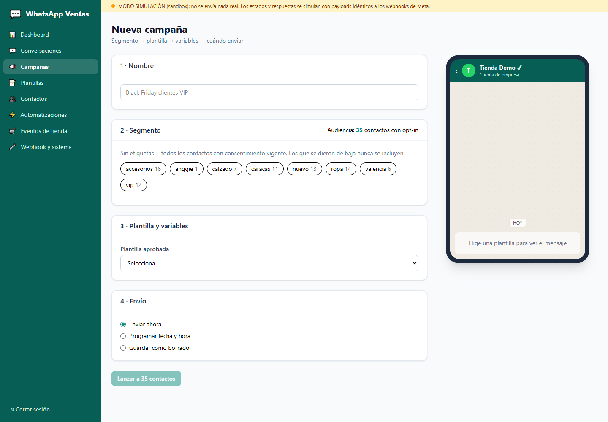 |
| **Plantillas** | **Editor de plantilla con vista previa** |
| 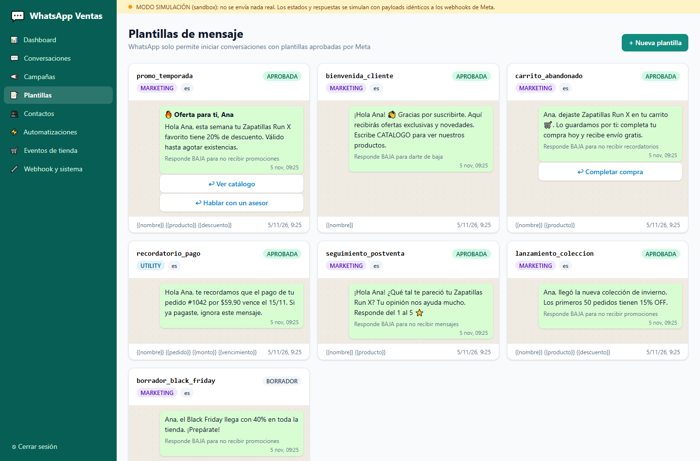 | 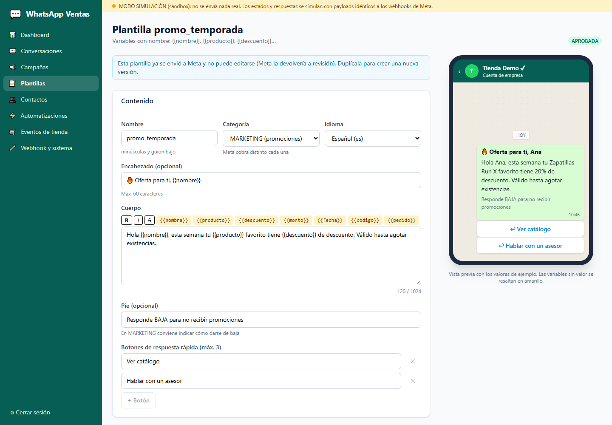 |
| **Contactos con consentimiento (opt-in)** | **Automatizaciones** |
| 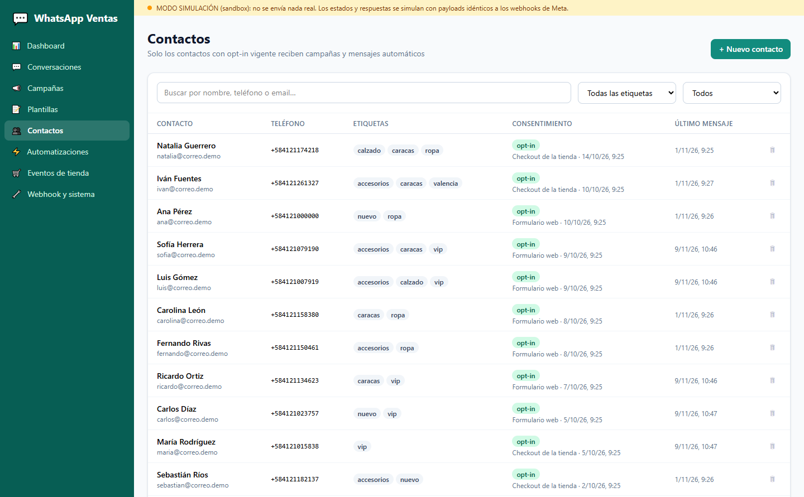 | 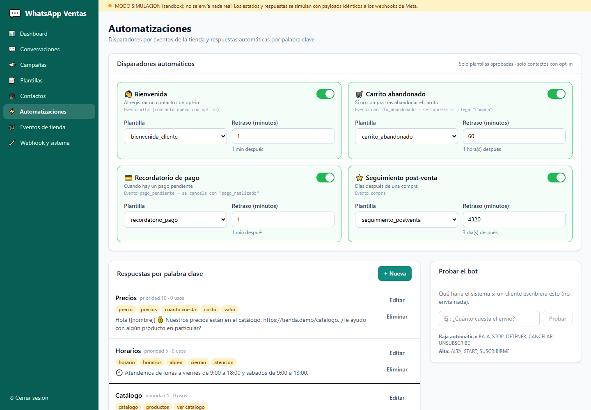 |
| **Eventos de tienda** | **Webhook y sistema** |
| 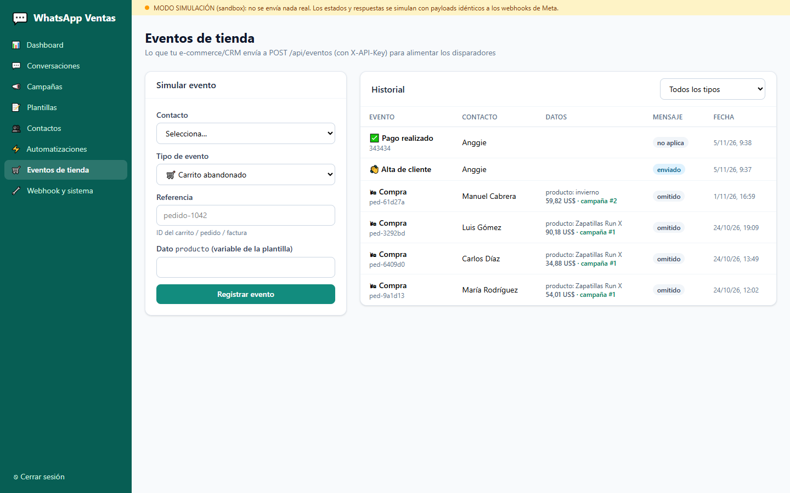 | 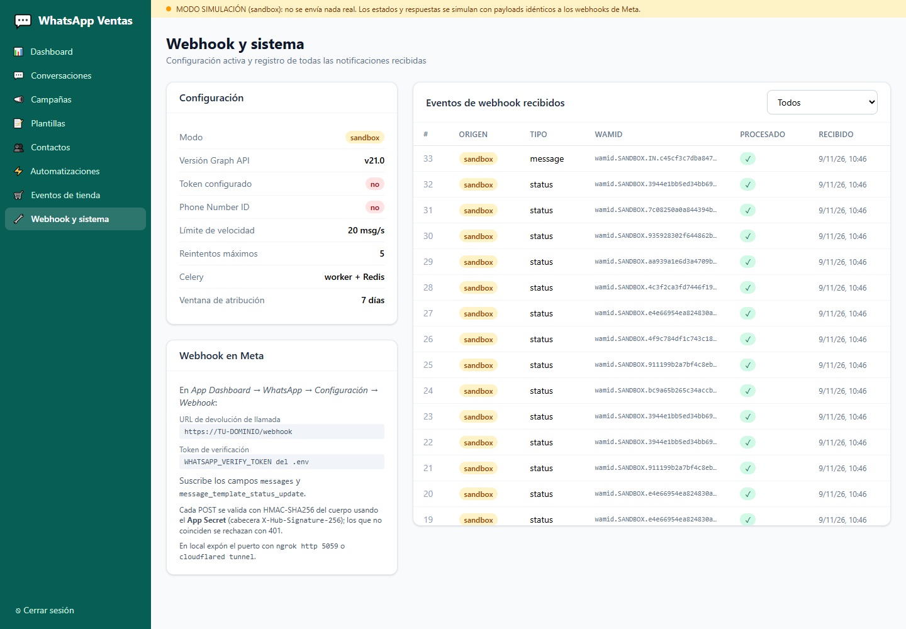 |

---

## Arquitectura

```
                ┌──────────────── React + Vite (5174) ────────────────┐
                │ Dashboard · Bandeja · Campañas · Editor de plantillas│
                └───────────────────────┬──────────────────────────────┘
                                        │ /api (JWT)
 E-commerce/CRM ── POST /api/eventos ──►┌┴──────────────────────┐
   (X-API-Key)                          │   FastAPI (5059)       │◄── POST /webhook ── Meta
                                        │  valida firma HMAC     │    (X-Hub-Signature-256)
                                        └──┬──────────────┬──────┘
                                           │              │ .delay()
                                     PostgreSQL        Redis (cola "whatsapp_ventas")
                                           ▲              │
                                           │     ┌────────┴─────────┐
                                           └─────┤  Celery worker    ├──► Graph API /messages
                                                 │  + beat (30 s)    │    (rate limit global
                                                 └──────────────────┘     + reintentos)
```

- **El webhook solo registra y encola.** Responde a Meta en milisegundos; cada estado o mensaje se guarda en `eventos_webhook` y lo procesa un worker. Si un estado llega antes que el `wamid` del envío, la tarea se reintenta.
- **Envío idempotente.** Cada mensaje se "reclama" con un `UPDATE … WHERE estado='en_cola'` atómico, así un reintento o un rescate de mensajes atascados nunca produce un envío duplicado.
- **Rate limiting global** en Redis (ventana de 1 s compartida por todos los workers) + **backoff exponencial con jitter** ante 429, 5xx y códigos de límite de Meta.
- **Programación sin countdowns largos.** Campañas programadas y disparadores con retraso (p. ej. post-venta a 3 días) se guardan con su fecha en PostgreSQL; Celery Beat los toma cada 30 s. Nada depende de que una tarea sobreviva días en Redis.

## Base de datos

| Tabla | Contenido |
|---|---|
| `contactos` | Teléfono E.164, nombre, etiquetas (segmentos), estado de opt-in vigente, contadores de bandeja |
| `consentimientos` | Registro **inmutable** de cada opt-in/opt-out: fecha, origen (formulario, checkout, WhatsApp, palabra clave…) y evidencia |
| `plantillas` | Encabezado, cuerpo con variables con nombre, pie, botones, ejemplos, estado en Meta |
| `campanas` | Plantilla, segmento, variables, fecha programada, estado |
| `mensajes` | Cada mensaje entrante/saliente con `wamid`, estado, intentos y marcas de tiempo (enviado, entregado, leído, respondido) |
| `eventos_webhook` | Payload crudo de cada notificación de Meta (o del sandbox), procesado/error |
| `eventos_negocio` | Eventos de la tienda (carrito, pago, compra) que alimentan disparadores y la atribución de conversiones |
| `disparadores`, `respuestas_automaticas` | Configuración de automatizaciones |

## Puesta en marcha (Windows)

Requisitos: Python 3.12+, Node 20+, PostgreSQL y Redis (en Windows: [Memurai](https://www.memurai.com/)).

```powershell
# 1. Base de datos (una sola vez, como superusuario)
psql -U postgres -f backend/scripts/crear_bd.sql

# 2. Backend
cd backend
python -m venv venv
venv\Scripts\pip install -r requirements.txt
copy .env.example .env
venv\Scripts\alembic upgrade head
venv\Scripts\python -m app.seed --reset          # datos de demostración

# 3. Tres terminales en backend/
venv\Scripts\uvicorn app.main:app --port 5059 --reload
venv\Scripts\celery -A app.worker worker --pool=threads --concurrency=8 -l info
venv\Scripts\celery -A app.worker beat -l info

# 4. Frontend
cd ..\frontend
npm install
npm run dev                                       # http://localhost:5174
```

Usuario demo: **admin@demo.com / admin123**. Documentación interactiva del API: http://localhost:5059/docs

> **Demo sin Redis ni worker:** pon `CELERY_EAGER=true` en `.env` y basta con levantar uvicorn. Las tareas se ejecutan en el propio proceso y la API recorre las programadas cada 30 s.

> **Redis compartido:** la app usa la base de Redis `3` y su propia cola `whatsapp_ventas`, para no mezclarse con otros proyectos Celery que usen el mismo servidor.

## Recorrido de la demo (modo sandbox)

1. **Dashboard:** KPIs de envío, entrega, lectura, respuesta y conversiones con datos de dos campañas históricas.
2. **Plantillas → Nueva:** escribe el cuerpo, inserta `{{producto}}` y `{{descuento}}` y mira la vista previa en el teléfono. *Enviar a revisión de Meta* → en sandbox se aprueba al instante.
3. **Campañas → Nueva:** elige segmento (`vip`), plantilla y variables → *Lanzar*. En el detalle verás los mensajes pasar de *en cola* a *enviado*, *entregado* y *leído*; algunos clientes simulados responden.
4. **Conversaciones:** abre un hilo y usa *Simular mensaje del cliente*:
   - `¿cuál es el precio?` → responde la regla de palabras clave *Precios*.
   - `STOP` → el contacto queda dado de baja (se ve en Contactos → historial de consentimiento) y ya no recibe campañas.
   - Con la ventana de 24 h abierta puedes responder a mano; cerrada, solo con plantilla.
5. **Eventos de tienda:** registra un *carrito abandonado* (mensaje programado a 60 min) y luego una *compra* del mismo contacto: el recordatorio se cancela y la compra se atribuye a la última campaña.
6. **Webhook y sistema:** el payload JSON de cada notificación recibida.

## Pasar a la API real

Sigue **[docs/guia-meta-cloud-api.md](docs/guia-meta-cloud-api.md)**: creación de la cuenta de desarrollador, app, número y **token de prueba**, configuración del webhook con ngrok, envío de plantillas a revisión y token permanente. Después:

```ini
WHATSAPP_MODE=cloud
WHATSAPP_TOKEN=EAAG...
WHATSAPP_PHONE_NUMBER_ID=1234567890
WHATSAPP_BUSINESS_ACCOUNT_ID=9876543210
WHATSAPP_APP_SECRET=...
WHATSAPP_VERIFY_TOKEN=un-texto-que-tu-elijas
```

## Integración con la tienda

```bash
curl -X POST http://localhost:5059/api/eventos \
  -H "X-API-Key: clave-integracion-demo" -H "Content-Type: application/json" \
  -d '{"telefono":"584121234567","tipo":"carrito_abandonado","referencia":"cart-991","datos":{"producto":"Zapatillas Run X"}}'
```

Tipos: `alta`, `carrito_abandonado`, `pago_pendiente`, `pago_realizado`, `compra` (con `monto`). Las claves de `datos` se usan como variables de la plantilla del disparador.

## Pruebas

```powershell
cd backend
venv\Scripts\pytest -q      # firma del webhook, plantillas, palabras de baja, teléfonos, auth
```

## Estructura

```
backend/
  app/
    api/          rutas FastAPI (contactos, plantillas, campañas, conversaciones, automatizaciones, eventos, dashboard, webhook)
    services/     lógica de negocio (envío, campañas, disparadores, procesamiento del webhook, consentimientos)
    whatsapp/     cliente Graph API, cliente sandbox, firma HMAC, rate limiter
    tasks.py      tareas Celery (envío con reintentos, campañas, disparadores, simulación)
    seed.py       datos de demostración
  alembic/        migraciones
  tests/
frontend/
  src/pages/      una página por módulo
  src/components/ UI base y vista previa estilo WhatsApp
docs/
  guia-meta-cloud-api.md
```
